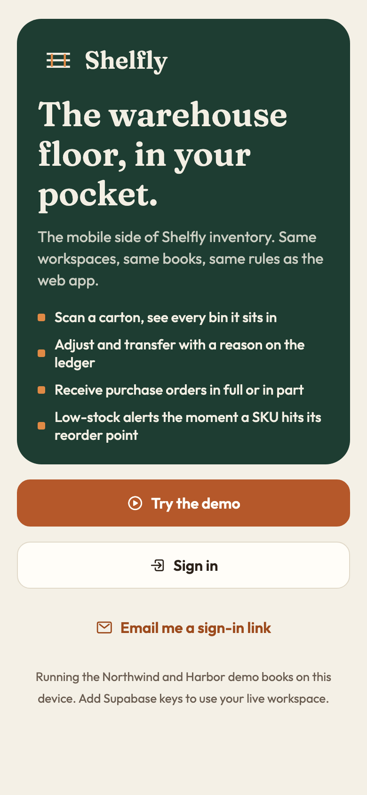
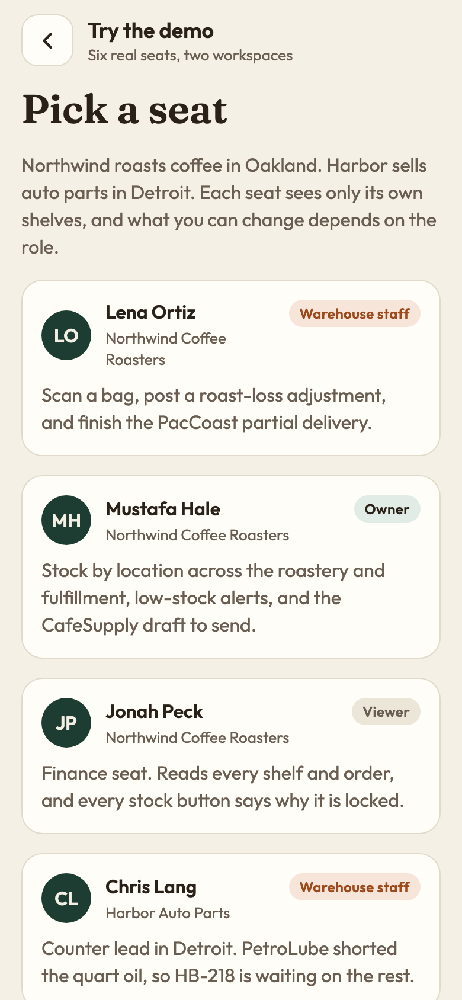
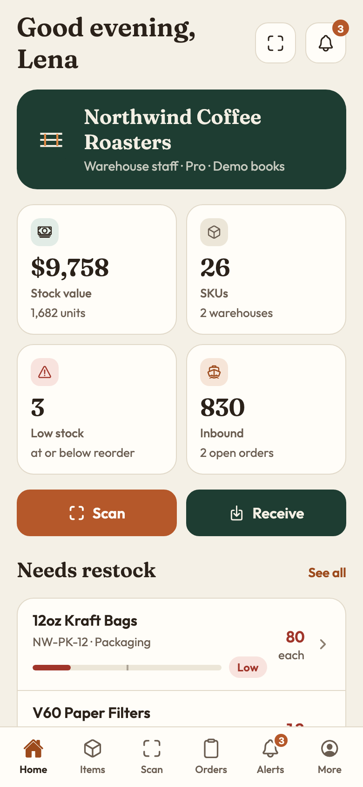
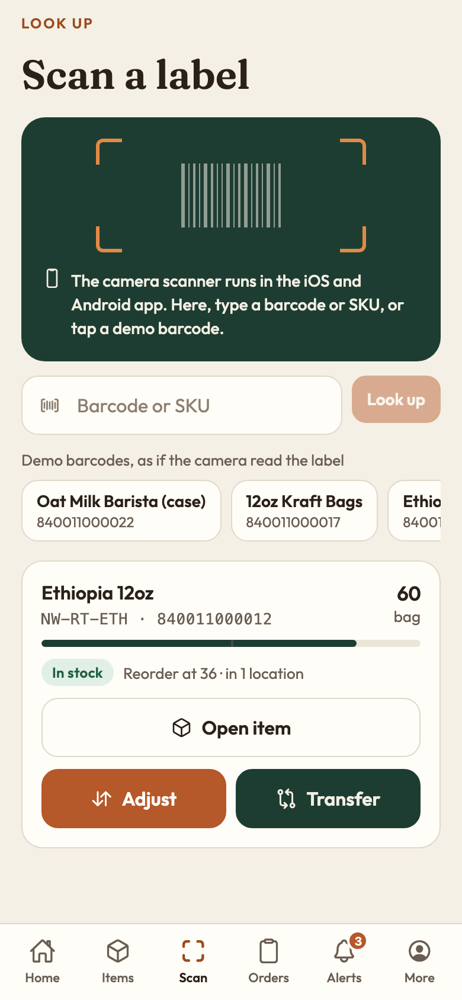
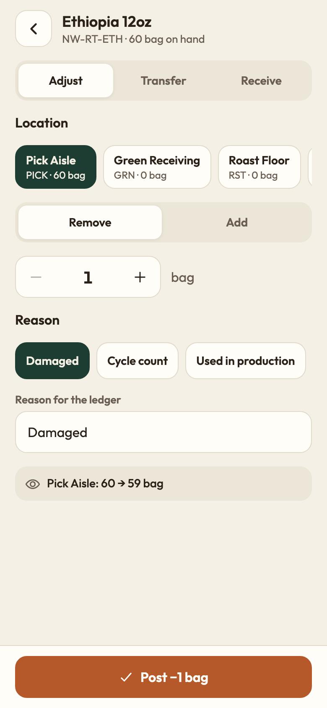
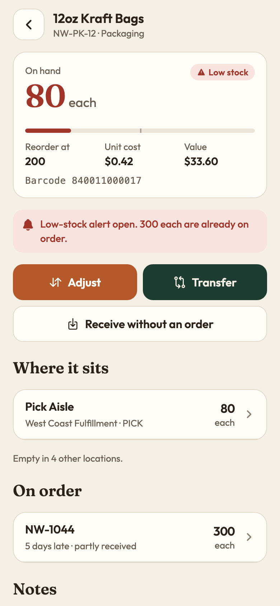
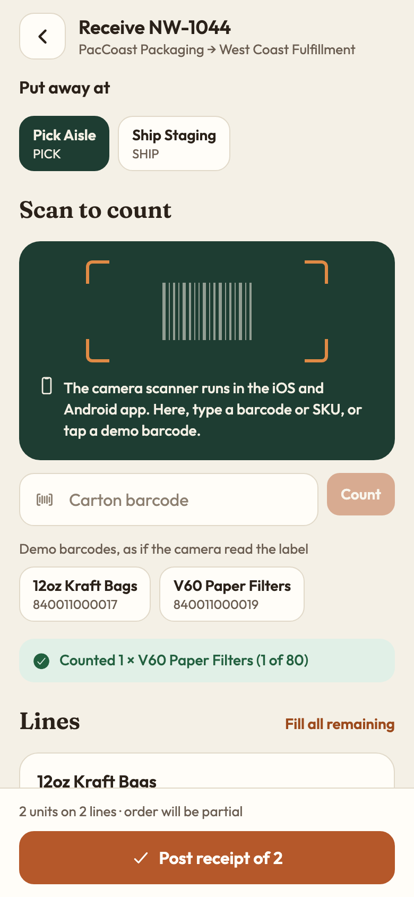
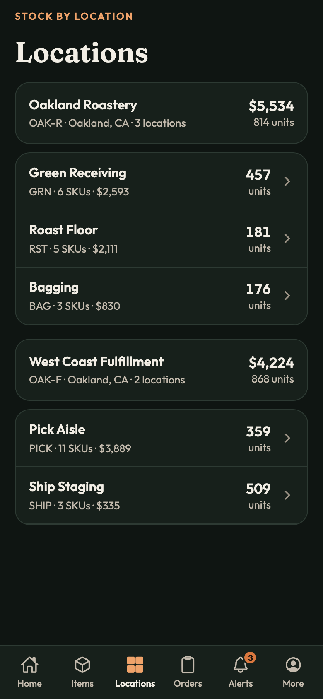
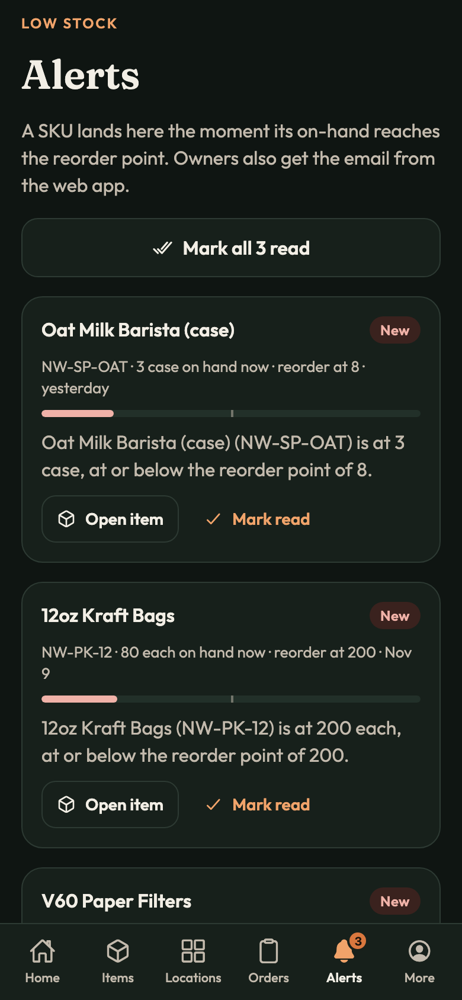
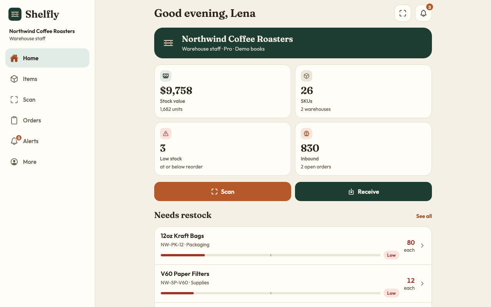

# Shelfly Mobile

Shelfly Mobile is the warehouse-floor companion to [Shelfly](../shelfly), the multi-tenant inventory SaaS. Staff scan a barcode to find a SKU, adjust stock with a reason, move stock between locations, and receive purchase orders in full or in part by scanning cartons. Owners see stock by location and low-stock alerts. Viewers can read everything and change nothing.

It talks to the same Supabase project as the web app when you give it the public URL and anon key. With no environment variables it runs the web app's demo books (Northwind Coffee Roasters and Harbor Auto Parts) on the device.

Bundle identifier: `com.quvantic.shelfly`. Scheme: `shelfly://`. Web preview target: [shelfly-app.quvantic.com](https://shelfly-app.quvantic.com).

## Screens

| | | |
| --- | --- | --- |
|  |  |  |
|  |  |  |
|  |  |  |

On a tablet or a wide browser the tab bar becomes a side rail:



Screenshots come from the web export (`npm run screenshots`), so the scanner panel shows the web fallback. On a phone that panel is the live camera.

## Features

- **Sign in** with email and password, or a magic link. In the demo the link arrives in an on-device inbox. Unknown emails get the same "link is on its way" answer.
- **Try the demo** as one of six seats: warehouse staff, owner and viewer at Northwind; staff and owner at Harbor; and a Shelfly super admin who can open both.
- **Workspace switcher** in More. The tabs, data and permissions follow the active workspace and role.
- **Role-aware navigation.** Warehouse staff get Scan in the tab bar. Owners, super admins and viewers get Locations there instead. Both screens stay reachable for everyone from Home and More.
- **Barcode scan** with `expo-camera` (UPC-A/E, EAN-8/13, Code 128, Code 39, QR), torch toggle, haptics and a duplicate-read guard. A 12-digit UPC and the same code read as 13-digit EAN match the same SKU. Shelfly shelf-label links (`shelfly://item/<id>`) work too. The web preview explains that the camera is phone-only and keeps a typed field and demo barcodes.
- **Items** with search by SKU, name, barcode or category, low-stock and category filters, and a stock bar against the reorder point.
- **Item detail**: on hand, value, stock per location, what is already on order, notes and the movement history.
- **Adjust, transfer, receive** from one screen with a live preview ("Pick Aisle: 60 → 58 bag"). Adjustments need a reason. Transfers cannot overdraw the source. A warning shows before a change drops a SKU to its reorder point.
- **Purchase orders**: open, draft and received lists with progress. Staff and owners can mark a draft as sent.
- **Receive by scanning**: choose the put-away location, scan cartons (each scan counts one unit against the matching line, refusing codes that are not on the order and anything past what is still owed), or set counts by hand. Post a partial receipt or close the order.
- **Low-stock alerts** with an unread badge on the tab, mark one or all read, and a local notification when your own change opens a new alert. Tapping the notification opens the item.
- **Push wiring** with `expo-notifications`: permission, Android channel, Expo push token registration (stored in `push_tokens` in Supabase mode), and a "Send a test alert" button. In a simulator or the web preview this is mocked locally and says so.
- **Offline-friendly**: every read is cached per person and workspace. Offline, Shelfly shows the last saved copy with a banner. Stock changes need a connection, so two people never post the same count twice.
- **Deep links** for items, locations, purchase orders, receiving and magic-link callbacks (`shelfly://` and `https://shelfly-app.quvantic.com`). A link opened while signed out opens right after sign-in.
- Light, dark and system appearance. Loading, empty and error states on every list. Accessibility labels on every control.

## Architecture

```
src/app            Expo Router screens: (tabs) for the main bar, stack screens for detail and actions
src/domain         Model (mirrors the web schema), stock rules, barcode matching, roles, formatting
src/data           ShelflyRepository, mock engine + demo seed, Supabase adapter, shared views, read cache
src/ui             Design system, scanner (native camera / web fallback), tab bar and rail
src/workspace      Session, active workspace, online state, push registration
supabase/migrations The web app's schema (copied unchanged) plus the mobile push_tokens table
scripts            generate-icons.mjs (app icon, splash, favicon from the Shelfly mark), capture-screenshots.mjs
```

Every screen talks to `ShelflyRepository`. `createRepository` picks the implementation:

| `EXPO_PUBLIC_SUPABASE_URL` | `EXPO_PUBLIC_SUPABASE_ANON_KEY` | Mode |
| --- | --- | --- |
| empty | empty | Mock. The web app's demo books, persisted on the device with AsyncStorage. |
| set | set | Supabase. The signed-in user's JWT, so row level security decides every read and write. |

Both implementations build a `TenantSnapshot` for the active workspace and render it through the same functions in `src/data/views.ts`, so "low", "remaining" and "value" mean the same thing in both modes. In mock mode, writes go through `src/data/engine.ts`, which applies the same rules as the web app's `lib/engine.ts`. In Supabase mode, writes go through the web app's SQL functions `public.apply_movement` and `public.receive_purchase_order`, alerts and draft orders are updated under the existing RLS policies, and the app never holds a service-role key. The demo session lives in SecureStore on the phone; the Supabase session uses AsyncStorage, the storage supabase-js documents for Expo.

Roles are the web app's: `owner`, `warehouse_staff`, `viewer`, plus `profiles.is_super_admin`.

## Demo seats

These exist only in mock mode. The password for every seat is `shelfly-demo`.

| Person | Workspace | Role | Email |
| --- | --- | --- | --- |
| Lena Ortiz | Northwind Coffee Roasters | Warehouse staff | floor@northwind.demo |
| Mustafa Hale | Northwind Coffee Roasters | Owner | owner@northwind.demo |
| Jonah Peck | Northwind Coffee Roasters | Viewer | audit@northwind.demo |
| Chris Lang | Harbor Auto Parts | Warehouse staff | floor@harbor.demo |
| Priya Shah | Harbor Auto Parts | Owner | owner@harbor.demo |
| Avery Quinn | Both | Super admin | admin@shelfly.demo |

Things to try: scan `840011000012` (Ethiopia 12oz) as Lena and post a damaged adjustment; receive NW-1044 (PacCoast, already partly in) by tapping the demo barcodes; send the NW-1048 draft as Mustafa; search "Ethiopia" as Priya and find nothing. More → Reset demo books puts everything back.

## Run

```bash
npm install
npx expo start
```

- **Expo Go**: scan the QR code from `npx expo start`. The camera scanner works in Expo Go.
- **Web preview**: `npm run web` (port 4417), or `npm run build:web` and serve `dist/` (`npx serve -s dist`). Host `dist/` at `shelfly-app.quvantic.com` as a single-page app.
- **EAS**: `eas.json` has `development`, `preview` and `production` profiles. Nothing here runs a paid EAS build. `npx eas-cli@latest build --profile preview` needs an Expo account; replace the placeholder `extra.eas.projectId` in `app.json` with the one `eas init` gives you.
- **Icons**: `npm run icons` redraws every PNG in `assets/images` from the Shelfly mark.

To use your Supabase project, copy `.env.example` to `.env` and set both values. Apply `supabase/migrations/20261125120000_shelfly_init.sql` (skip it if the web app already did) and `20261126090000_mobile_push_tokens.sql`. In Supabase Auth → URL configuration, add `shelfly://auth/callback` and `https://shelfly-app.quvantic.com/auth/callback` to the redirect URLs so magic links come back to the app.

## Tests

```bash
npm run lint
npm run typecheck
npm test                 # Jest + React Native Testing Library
npm run build:web
npx playwright install chromium
npm run test:e2e         # Playwright against the web export, 390 × 844
npm run screenshots      # refresh docs/screenshots from dist/
```

- Jest (41 tests): stock math, barcode and search matching, formatting, data mode, the demo books and views (tenant isolation, location value, PO ordering), the mock repository end to end (sign-in, magic link, adjust with reason, transfer overdraw, partial then full receipt, drafts, viewer lockout, alerts, super-admin switching, persistence and reset), the offline read cache, and the stepper, scan panel and chip components.
- Playwright (7 flows): scan and adjust, receive a PO by scanning in two deliveries, transfer between locations, owner locations + draft + alerts, viewer lockout, tenant isolation + super-admin switch, password sign-in + magic link + deep link after sign-in.
- Maestro flows in `.maestro/` cover scan-and-adjust, receiving, the owner's view, viewer and tenant limits, and the magic link. They target `com.quvantic.shelfly` and need a simulator or dev build: `maestro test .maestro/`.

CI (`.github/workflows/ci.yml`) runs lint, typecheck, Jest, the web export and Playwright on `ubuntu-latest` with Node 22 and no secrets.

## What a person still has to do

- Apple Developer and Google Play accounts for store builds, and an Expo account plus `eas init` for EAS builds and real push tokens.
- The Supabase project URL and anon key in `.env`, the migrations applied, and the two magic-link redirect URLs added in Supabase Auth.
- DNS for `shelfly-app.quvantic.com` pointing at wherever `dist/` is hosted, and `apple-app-site-association` / `assetlinks.json` on that domain if you want universal links to open the app.
- A server job (or Supabase Edge Function) that sends Expo pushes to `push_tokens` when the web app opens a low-stock alert. The app registers tokens and shows local alerts; it does not send pushes to other people.

## Provenance

The original Cursor agent run for this app stopped at its usage limit and its code could not be recovered, so this app was rebuilt from the original brief, the five sibling companion apps (same stack, tooling and test setup), and the Shelfly web app's schema, rules, demo data and brand.
